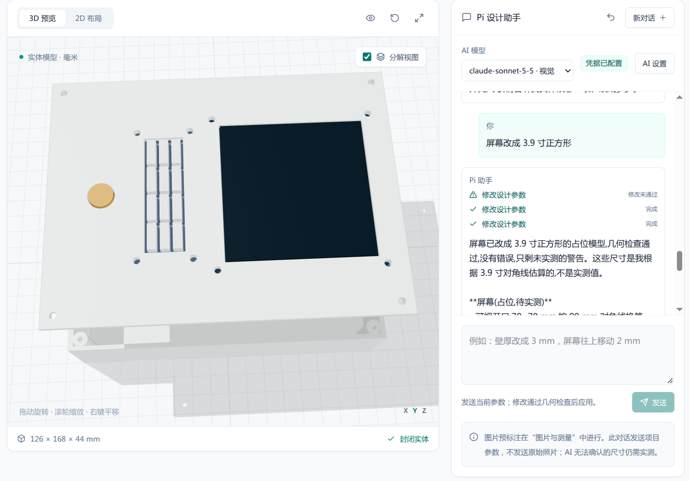
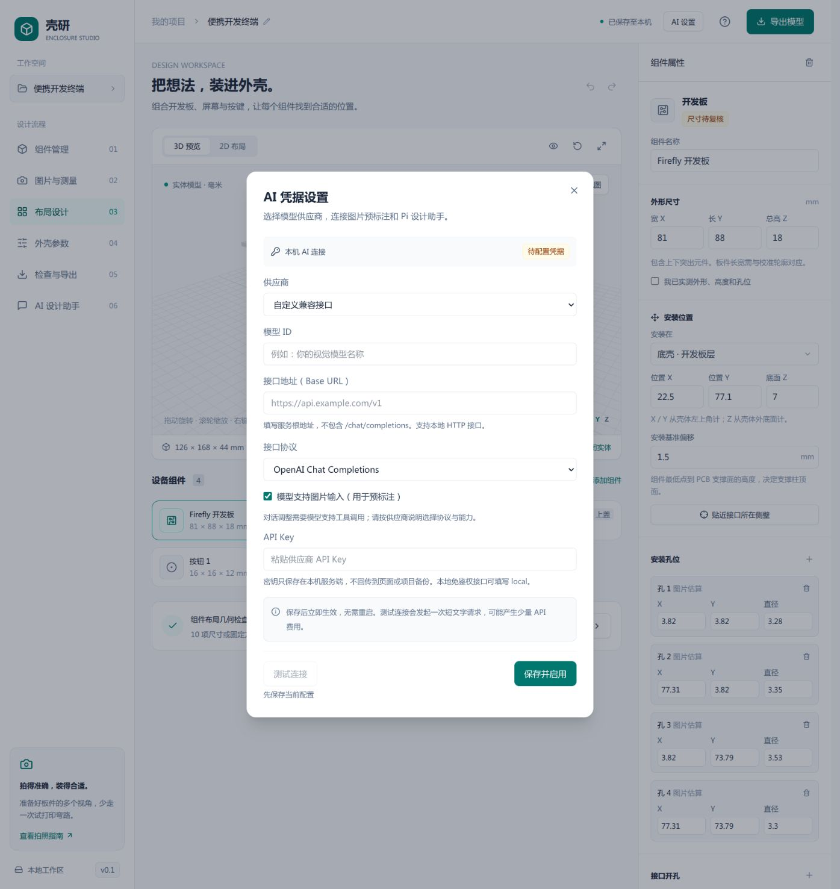
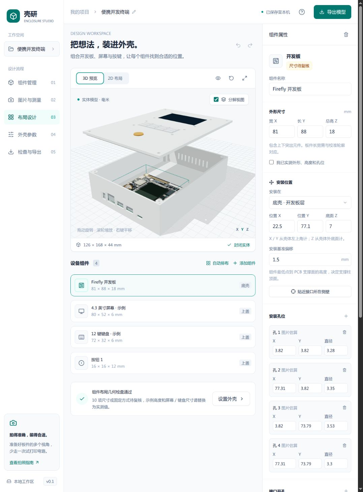
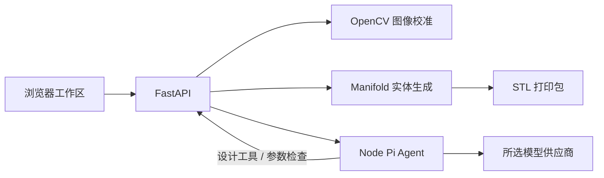

# 壳研 · Enclosure Studio

从开发板、屏幕和按键的**照片与实测尺寸**出发，设计可 3D 打印的设备外壳。用 [Pi Agent](https://pi.dev/) 预标注图片、通过对话调整参数，在同一个工作区完成布局、实体预览、几何检查和 STL 导出。

支持开发板、屏幕、键盘、面板按钮、开关、旋钮、电池、扬声器和扩展模块，可在底壳、上盖或四个侧壁安装，面向本地使用。

[快速开始](#快速开始) · [AI 配置](#ai-配置) · [使用流程](#使用流程) · [完整使用指南](docs/user-guide.md)



*对话调整示例：将屏幕改为 3.9 英寸正方形占位模型。截图中的 AI 估算尺寸仍需实测复核。*

## 可以做什么

| 能力 | 使用方式 |
| --- | --- |
| 多组件外壳 | 九类组件模板，设置底壳、上盖或四个侧壁安装面 |
| 照片测量 | 上传多视角照片，以已知长宽和 PCB 四角做透视校准，提取圆孔候选 |
| AI 预标注 | 识别安装孔、显示区、按键区、接口和遮挡物，编辑候选后采用 |
| 2D / 3D 设计 | 拖动布局、输入精确坐标，查看实体装配及分解视图 |
| 对话调整 | 用自然语言调整尺寸、位置、开口和通风孔，检查通过后应用，支持撤销 |
| 参数化结构 | 四角圆角、三种面板开孔、侧向支撑柱、上盖螺丝头沉孔和配合参数 |
| 打印与备份 | 导出底壳、上盖 STL 和安装孔试打印小样；以项目 JSON 备份照片与参数 |

## 快速开始

需要 **Node.js 22.19+** 和 **Python 3.11+**。以下命令适用于 macOS / Linux。

```bash
git clone https://github.com/dodola/enclosure-studio.git
cd enclosure-studio

python3 -m venv .venv
.venv/bin/python -m pip install -r server/requirements.txt
npm ci

npm run dev
```

打开 **http://localhost:5176**。启动命令会同时运行前端、FastAPI 几何服务与 Node Pi 服务。AI 为可选能力；未配置凭据时仍可手动测量、设计外壳和导出 STL。

| 服务 | 默认地址 | 用途 |
| --- | --- | --- |
| Vite | `http://localhost:5176` | 开发工作区 |
| FastAPI | `http://127.0.0.1:8011` | 图像校准、几何检查、实体生成与导出 |
| Pi | `http://127.0.0.1:8012` | AI 预标注与流式对话，由 FastAPI 代理 |

局域网部署（带管理员登录）：

```bash
npm run setup:login
npm run build
npm start
```

构建后打开 **http://localhost:5176**，同一局域网设备访问 `http://服务器局域网IP:5176`。首次配置生成 `admin` 账户，随机密码保存在本机 `.pi-state/login-password.txt`；页面与全部业务接口均需登录，Pi 仅监听本机且验证内部凭据。

Linux 可停止开发服务后运行 `npm run deploy:service`，安装自动启动的 systemd 用户服务。账户管理、重启和部署细节见 [局域网部署指南](docs/lan-deployment.md)。项目仍保存在各浏览器，跨设备可用项目 JSON 导入导出，尚无同步功能。当前使用局域网 HTTP；需要传输加密时在服务前配置 HTTPS 反向代理。

## AI 配置

点击页面顶部或 AI 面板中的 **AI 设置**：

1. 选择 Anthropic、OpenAI、Google Gemini 或自定义兼容接口。
2. 选择模型并填写 API Key。自定义接口还需填写 Base URL、协议及图片支持能力。
3. 点击 **保存并启用**，立即生效，无需重启。
4. 点击 **测试连接** 验证一次短文字调用；图片预标注需要视觉能力，对话调整需要工具调用能力。

兼容协议包括 OpenAI Chat Completions、OpenAI Responses、Anthropic Messages 和 Google Generative AI。也可连接本地 HTTP 模型端点；免鉴权端点的 API Key 可填 `local`。

<details>
<summary>查看 AI 凭据设置截图</summary>



</details>

密钥仅保存在本机服务端 `.pi-state/ai-settings.json`，不回传到页面、不写入项目备份，且被 Git 忽略。保存后输入框清空，留空保留原密钥。这是本机文件保存，不是加密保险库。AI 请求会发送相应图片或设计参数给所选供应商。

也支持 `.env.example` 中的服务端环境配置和已有 Pi 认证文件。页面保存的同供应商设置优先于环境配置；不要使用 `VITE_` 前缀存储密钥。

连接失败时，页面显示上游 HTTP 状态、模型、协议及已识别的错误码。模型出现在供应商列表中不等于该 Key 拥有生成权限。更多说明见 [AI 配置与连接诊断](docs/user-guide.md#pi-ai-预标注与对话调整)。

## 使用流程

1. **添加组件**：输入实际长宽高，替换初始示例尺寸。
2. **准备照片**：分别上传正面、背面、接口侧面和高度侧面照片。正反面镜头垂直板面，四个 PCB 角完整入镜。
3. **校准与复核**：用已知长宽校准轮廓，选择安装孔用途；采用 AI 标注前核对坐标、孔径和开口。
4. **设计布局**：安排底壳层与上盖层，设置支撑面、屏幕/键盘开口、按钮孔和接口位置。
5. **调整外壳**：手动设置参数，或发送“外壳四角设为 R12”“外壳加高 5 mm”“屏幕往上移动 2 mm”等要求。
6. **检查与试打印**：处理几何错误，先打印安装孔小样验证孔位，再导出底壳和上盖试装。

<details>
<summary>查看组件布局与外壳分解预览</summary>



</details>

## AI 如何修改模型

Pi 使用受限的领域工具操作当前项目：

- `inspect_design`：读取最新设计。
- `edit_design`：修改外壳、组件、孔位或接口参数。
- `auto_layout`：排布组件。
- `list_component_templates`：查看组件模板与示例尺寸。
- `add_component`：从模板添加指定安装面的组件，检查通过后应用。

每次修改先通过几何检查和实体生成，再在本次对话完成时应用并更新预览。停止、失败或期间发生新的设计修改时，未完成的草稿不会覆盖当前设计。Agent 没有文件、命令或任意网络工具。



照片校准和几何生成在本机完成。AI 预标注发送当前视角照片与尺寸，设计对话发送参数；STL 始终由确定性几何程序生成。Pi 官方接口及接入依据见 [集成说明](docs/pi-integration.md)。

在 **外壳参数 → 四角圆角半径 R** 设置 `cornerRadius`，或让 Pi 设置相同参数。默认 R0 保留直角，最大半径为宽度与长度中较小值的一半。内腔半径为 `max(0, R − 壁厚)`，定位边和角部螺丝柱同步调整；2D、实体预览和 STL 使用同一参数。组件与支撑柱进入内圆弧，或接口开孔进入圆角区时会阻止导出。当前只支持沿高度方向的四角圆角，顶面/底面边缘圆角和倒角尚不支持。

多安装面、侧向孔位和当前固定结构边界见 [下一版能力规划](docs/roadmap-v0.2.md)。可以对 Pi 说“在左侧用示例尺寸添加一个面板按钮，保持开发板尺寸和位置”，或“上盖螺丝头沉孔直径 6.4 mm、深度 1 mm”。示例模板始终待实测；电池占位不代表已有托架，扬声器声孔不含保护网。

## 测量与打印边界

- 图片标注是估算，不能替代实测。单张照片无法可靠恢复不可见高度、安装基准、孔深或排线空间。
- 组件沿外壳坐标轴安装，支持四个侧壁方向，采用螺丝固定的两片外壳；暂不支持任意旋转、卡扣、打印螺纹和 STEP 导出。
- 屏幕和键盘固定柱依赖真实安装孔；圆按钮需要使用螺母等实际固定方式。
- 碰撞检查使用组件包围盒，不能代替详细的器件、线缆、散热和装配验证。
- 几何错误会阻止导出。未实测尺寸会保留待复核标记，请先用小样验证，再试装完整外壳。
- 示例中的孔位来自图片估算；高度、接口、屏幕和键盘尺寸包含明确标记的占位值。

坐标以毫米计：俯视原点在外壳左上，X 向右、Y 向下，Z 从外壳外底面向上。项目和照片保存在当前浏览器的 IndexedDB，可导出 JSON 备份。详细坐标、安装基准及接口规则见 [使用指南](docs/user-guide.md#坐标与安装基准)。

## 开发与验证

```bash
npm run build
npm test
```

Python 测试覆盖实图校准、孔位、碰撞、开孔、封闭网格和打印包。Node 测试通过受控本地模型端点运行真实 Pi SDK，验证工具循环、图片输入、流式会话、中止、凭据保存与错误脱敏；这些测试不代表真实供应商的识别精度。

| 路径 | 内容 |
| --- | --- |
| `src/` | React + TypeScript + Tailwind，Radix 控件和 Three.js 工作区 |
| `server/vision.py` | OpenCV 校准与孔位候选 |
| `server/models.py` | 参数模型与几何检查 |
| `server/geometry.py` | Manifold 底壳、上盖及小样实体 |
| `server/app.py` | FastAPI 图像、预览、导出及 AI 代理 |
| `agent/` | Pi SDK 会话、领域工具、凭据与连接诊断 |
| `docs/` | 使用指南、Pi 接入依据与 README 截图 |
