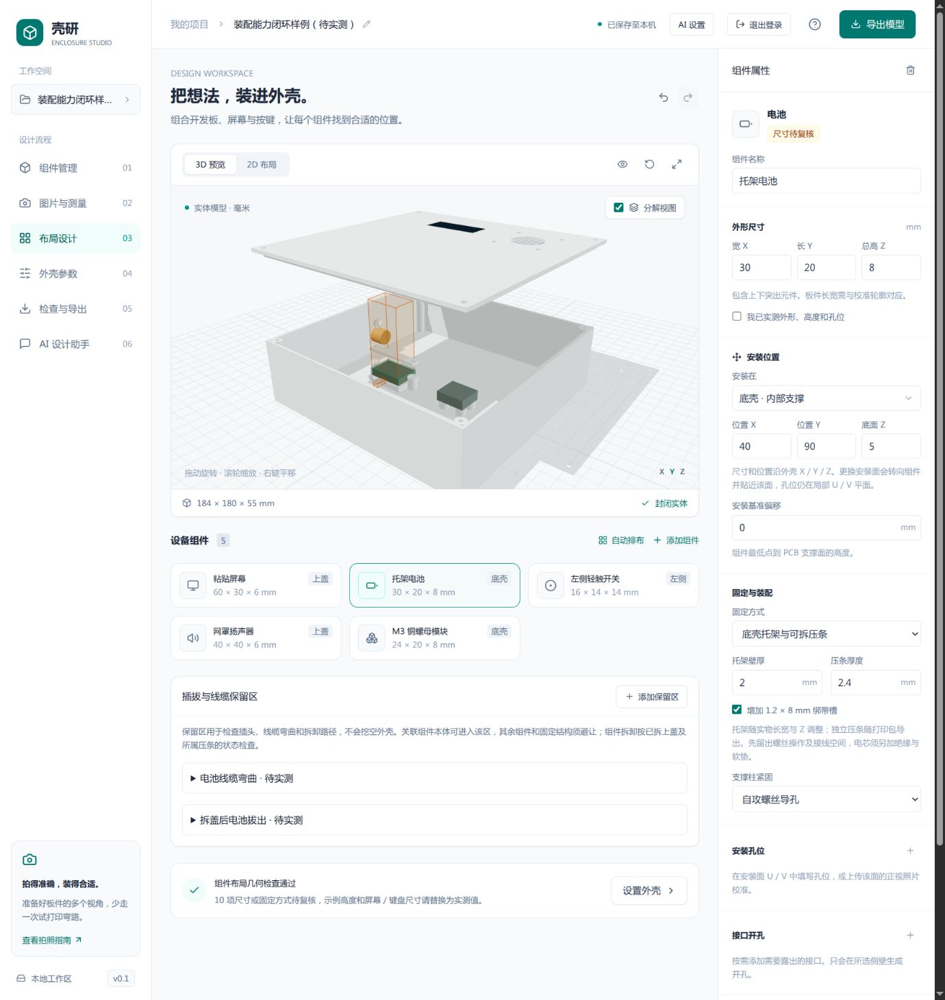
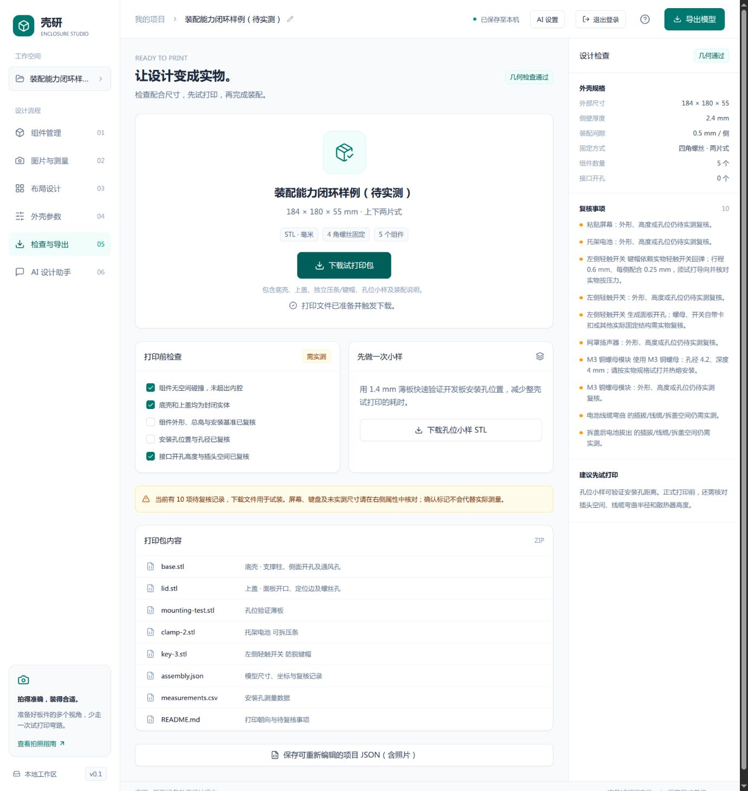
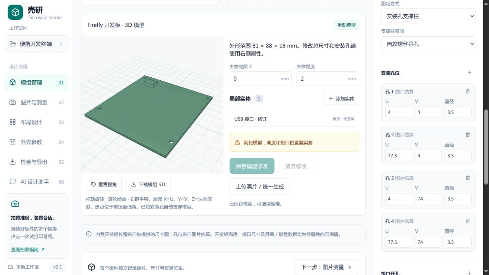

# 装配功能与工程流程闭环验收

验收日期：2026-10-14。来源：未完成对话 `01a133d4-c4eb-7e12-8e1d-1d91a9f5324d`，以及本次确认的“粘贴承托台、下一阶段装配能力、整体功能 review”范围。以 `4d1d9a7` 为审查起点，覆盖接续的装配功能、统一标注与可编辑模组模型实现。

## 交付结果

原任务留下了粘贴承托相关字段和局部代码，尚未完成实体、交互与导出的一致验收。本次完成上盖内侧承托，补齐固定结构与保留区，并将页面、Pi 工具、确定性几何、预览与打印包串联。

- 上盖屏幕/键盘内侧连续承托环：跟随安装基准和胶层厚度，外圈连接上盖；开口周围须留至少 1.2 mm 连续实物接触边框。保留平整的外表面打印朝向。
- 电池/模块/开发板底壳托架：承托底板、四边导向、两侧螺丝柱、可拆压条和可选绑带槽，压条独立 STL。
- 底壳 M3 热熔盲孔：可调孔径/深度，校验盲孔底与柱壁；压条 M3 通孔独立采用 3.2 mm，不再依赖壳体通孔参数。
- 四侧轻触按键：导向筒、独立防脱键帽、行程、配合间隙和外露尺寸；由实物开关提供回弹。
- 扬声器圆孔格栅：筋宽、净间距和厚度可调，本体须退到内壁后并保留装配间隙。启用、换面、自动排布遵守相同内缩规则。
- 线缆弯曲、插拔及拆卸保留区：显示于 2D/3D，随关联组件移动/删除，并检查实际壳体与独立件。拆卸按上盖、盖上组件和所属压条已移除的状态检查。

完整可导入样例：[assembly-example.json](../server/assembly-example.json)。含 5 个组件、2 个独立打印件、2 个保留区；扬声器包含明确的安装孔，所有尺寸与来源均保留待实测状态。

## 流程与模块边界

项目数据经 `/api/normalize` 生成规范字段，页面保留照片。共享设计逻辑负责安装面转换、移动与自动排布；Pi 使用同一数据语义。后端 `assembly.py` 提供装配尺寸计算，参数校验与实体生成复用这些计算。`build_kit` 生成底壳、上盖、独立件，预览与导出复用同一模型。

组件之间采用包围盒检查；生成的固定结构、独立件、壳体及保留区进一步执行实体交集检查。各 STL 必须体积为正、封闭且只包含一个连通实体。检查不能代替实际器件的详细形状和装配测量。

## Review 处理结果

工程轴与需求轴分别由并行只读审查检查；发现的问题均在当前范围内修复，最终未保留已知阻断项。

工程轴处理：

- 安装方式统一：关闭固定时不再生成实际柱，也不会因保留孔位触发柱/开口错误。
- 老项目导入补齐后端默认值，避免孔数组、孔来源等缺失导致页面崩溃。
- 照片校准取消与版本检查，避免切换组件/视角、替换照片后回写过时结果。
- 工作区恢复完成前不允许编辑；任何已存数据均先校验。恢复失败不自动保存示例，退出也不回写；提供原始数据备份及有效项目导入入口。
- 撤销/重做捕获当前项目快照，避免延迟执行的 React updater 读取已改变的 ref，导致重做无效。
- AI 忙会话采用锁归属检查：被拒绝的重复请求不能释放另一请求持有的会话锁。

需求轴处理：

- 承托位置从外表面改为内侧安装基准，防止错误打印朝向与承托高度。
- 拒绝零接触胶粘边框、扬声器/自身格栅干涉、固定结构重叠、压条相交以及定位边/角柱干涉。
- M3 孔径与配套通孔一致；拆卸路径考虑已拆盖状态；格栅扬声器自动排布保持合法内缩。
- 页面开放所有组件的接口编辑；Pi 创建参数与其描述匹配，支持装配参数与保留区，且不能伪造实测状态。

## 自动验证

执行 `npm test`：**69 项 Python 测试、20 项 Node 测试全部通过**。末次共享放置规则微调后再次运行完整 Node 测试，20 项仍全部通过。执行 `npm run build` 与 `git diff --check` 均通过。

覆盖：已有照片透视校准与孔位、六个安装面、圆角与开口、认证与同源保护、Pi 真实 SDK 工具调用/图片输入/失败回滚/中止/并发，以及新增装配结构的封闭性、连通性、配合与碰撞。

完整样例还通过真实 API 的“规范化 → 预览 → 导出 ZIP → 检查每个 STL → 重新导入 assembly.json”测试。导入后参数一致，STL 封闭、正体积、单连通，打印最低点 Z 为 0。

Pi 测试运行真实 SDK，通过受控本地模型端点返回工具调用，几何仍使用真实 Manifold。未用真实供应商执行外部图片识别，不据此声称模型识别精度或供应商连接已验证。

构建仍有 Three.js 异步包约 508 kB 的体积提示；测试环境另有 Starlette/httpx 弃用提示，均不阻断当前运行。

## 浏览器验收

使用隔离登录配置和回环测试服务，未改动生产账户或模型凭据。测试前备份浏览器原工作区，结束时恢复。

- 错误密码被拒，正确登录可进入工作区；退出后重新登录仍保留原项目。
- 导入完整装配样例，显示五个组件、两个保留区及封闭实体预览。
- 修改压条厚度 2.4 → 2.8 mm，撤销回到 2.4、重做回到 2.8；刷新后恢复保存数据。
- 将线缆保留区 X 改为 0，使其碰到侧壁：页面显示具体几何错误，打印包下载按钮禁用。
- 实际下载 ZIP，包含 base/lid/clamp/key STL、孔位小样、assembly.json、CSV 与装配 README；文件清单与页面一致。
- 上传仓库实图 `firefly-top.png`，手动完成 OpenCV 校准，得到 8 个圆孔候选；选择 4 个安装孔并采用，右侧孔位同步更新，仍标为图片估算。
- 使用隔离代理模拟 `/api/normalize` 503：显示恢复页；退出/重登前后两份原始数据备份逐字节一致，均保留五组件装配项目。恢复服务后从失败页直接导入有效备份，成功进入工作区。

## 本机服务验收

完成生产构建后重启现有 `enclosure-studio.service`，状态 `active`。本机服务的规范化、预览、导出接口均返回 200；未登录业务请求返回 401；内部 AI 配置代理返回 200；首页内容与当前构建一致。检查仅输出状态，不输出凭据。

## 实物验收与后续范围

软件流程已闭合；尚未进行物理打印、热熔安装及整机试装。默认 M3 孔径 4.2 mm / 深度 4 mm 为试打参数，不对应已验证的供应商规格。按实物确认材料、胶层、键帽回弹、螺丝长度、绝缘、线缆弯曲和散热，再打印关键局部及整壳。

当前保留原有九条通风槽规则。自由通风布局、圆柱电池槽、供应商铜螺母规格库、任意旋转、边缘倒角、卡扣和 STEP 属于后续范围。详细边界已同步 [使用指南](user-guide.md) 与 [路线图](roadmap-v0.2.md)。

## 追加验收：上传、统一标注与可编辑模组

- 移除上传和校准后的自动 AI，以及单张图片内的重复调用入口。新增显式按钮，当前模组 1–4 个已上传视角一并传给真实 Pi SDK。
- `agent/module-model.mjs` 校验完整视角覆盖、固定外形与模型参数；`server/module_geometry.py` 用 Manifold 布尔运算生成主体、附加/切除实体和贯通孔，拒绝越界、非连通或空模型。
- 独立模组预览不依赖外壳布局是否有效。模组管理支持旋转、缩放、参数草稿预览、校验后保存、撤销/重做、STL 下载；装配视图使用相同实体。照片、标注和模型保存在同一项目，生成结果为单次原子修改。
- 更换照片或修改参数时旧生成请求不能覆盖新状态；停止和页面卸载会取消请求。总尺寸缩小导致的越界作为可修正几何错误保存，避免刷新时丢失工作区。
- 自动检查：86 项 Python + 23 项 Node 通过，生产构建通过。新测试覆盖真实布尔孔/凹槽、6 个安装面方向与体积、断开/切空/越界拒绝、STL/项目/打印包往返，以及真实 SDK 的多图片输入、缺失视角拒绝和中止。
- 隔离浏览器验收：上传第三视角后模型供应商调用为 0；点击统一按钮后一次请求携带 top/bottom/side 三张图片。生成后自动进入模组页面；编辑厚度 1.6 → 2 mm、部件位置及名称，越界阻止保存；保存、撤销、重做、刷新恢复及实际 STL 下载均成功。手动校准后供应商请求数不增加。
- 受控供应商仅验证数据和工具流程，不代表真实视觉模型的识别精度。所有照片推断继续保持待实测状态。

本地常驻服务已重启并复核：5176 首页 200、健康状态 ok、模组预览 200 且封闭，新模组接口未登录返回 401，Pi 已公开 `module-model` 能力。
