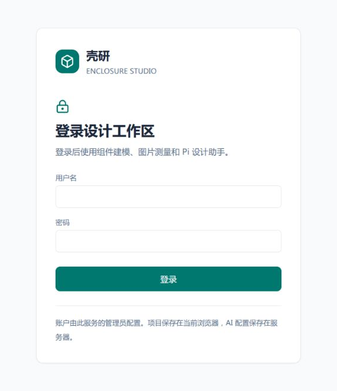

# 局域网部署与登录

生产入口是 FastAPI 提供的构建页面，默认监听 `0.0.0.0:5176`。图片测量、几何检查、STL 导出和所有 AI 接口共用这个入口；Pi 监听 `127.0.0.1:8012`，仅接受携带服务内部凭据的请求。

## 首次启动

```bash
npm run setup:login
npm run build
npm start
```

打开 `http://服务器局域网IP:5176`。默认账户 `admin` 的随机密码写入 `.pi-state/login-password.txt`，文件权限为 `600`。登录配置 `.pi-state/login.json` 保存用户名、scrypt 密码哈希和随机内部服务凭据，不保存用户密码原文；两个文件都被 Git 忽略。记录初始密码后可以删除 `login-password.txt`，不会影响登录。



也可直接在服务器终端指定用户名并输入自己的密码：

```bash
npm run setup:login -- --username admin --prompt
```

生产启动必须有有效的登录配置。无配置时 `npm start` 会退出，不能把验证关闭后开放服务。`npm run dev` 默认只监听本机，没有登录配置时仅用于本地开发；存在配置则同样启用验证。

## 常驻服务（Linux）

先停止该项目的 `npm run dev` 或 `npm start`，避免端口占用，再运行：

```bash
npm run deploy:service
systemctl --user status enclosure-studio
```

安装脚本在 `~/.config/systemd/user/enclosure-studio.service` 写入当前项目和 Node 的绝对路径，服务异常退出会重启。用户服务随用户会话启动；需要退出会话后继续运行以及开机启动时，由主机管理员为该用户启用 linger。

更新和排查：

```bash
npm run build
systemctl --user restart enclosure-studio
journalctl --user -u enclosure-studio -n 50
systemctl --user stop enclosure-studio
```

## 账户重置

在服务器终端运行以下命令，随后重启服务；既有登录会话将失效：

```bash
npm run setup:login -- --reset --username admin --prompt
systemctl --user restart enclosure-studio
```

当前为一个管理员账户，不含注册、多人权限和邮箱找回。管理员可以使用及修改全局 AI 设置；设计项目与照片按浏览器和访问地址保存在 IndexedDB，登录不会把它们上传到服务器。`localhost` 与局域网 IP 属于不同浏览器存储空间，可通过项目 JSON 迁移。

## 配置及会话

`.env` 或服务环境支持 `ENCLOSURE_HOST`（默认 `0.0.0.0`）、`ENCLOSURE_PORT`（默认 `5176`）、`ENCLOSURE_AUTH_FILE`（默认项目 `.pi-state/login.json`）、`PI_PORT`（默认 `8012`）。自定义登录配置路径时，首次配置命令也须传入同一个 `ENCLOSURE_AUTH_FILE` 环境变量；不要放在 `public/` 或 `dist/` 中。

会话在服务内存中保存，12 小时到期，Cookie 为 HttpOnly、SameSite=Strict。退出登录立即撤销当前会话；服务重启撤销所有会话。来自同一 IP 的 8 次失败登录后，15 分钟内拒绝继续尝试。跨源写请求被拒绝。内部服务凭据只在本机回环请求中有效，不能通过局域网绕过登录。

当前 HTTP 部署没有传输加密。在需要保护局域网中的密码和请求传输时，使用受信任证书的 HTTPS 反向代理；通过 HTTPS 登录会设置 Secure Cookie。开放到其他网络前应由部署者配置 HTTPS 与访问范围。
